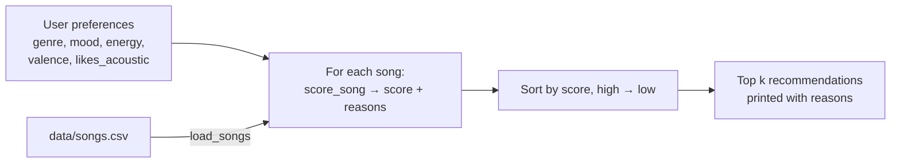

# 🎵 Music Recommender Simulation

## Project Summary

In this project you will build and explain a small music recommender system.

Your goal is to:

- Represent songs and a user "taste profile" as data
- Design a scoring rule that turns that data into recommendations
- Evaluate what your system gets right and wrong
- Reflect on how this mirrors real world AI recommenders

This version, **GenreGenie 1.0**, is a small content-based recommender that runs in the terminal. It loads a 20-song catalog from `data/songs.csv`, scores every song against a user's taste profile (favorite genre, favorite mood, target energy, target valence, and whether they like acoustic music), and prints the top 5 songs with a score and a plain-language list of reasons for each one.

---

## How The System Works

### How real recommenders work

Big platforms like Spotify and YouTube mix two ideas. **Collaborative filtering** looks at behavior: if lots of people who played song A also played song B, and you played A, you probably get B. It learns from likes, skips, replays, saves, playlist adds, and listening time, and it doesn't need to know anything about the music itself, but it struggles with brand-new songs and brand-new users (the "cold start" problem). **Content-based filtering** looks at the songs themselves: genre, mood, tempo, energy, how acoustic or danceable a track is. It compares those attributes to what a user already likes, so it works on day one, but it tends to keep suggesting more of the same. Real systems blend both at huge scale, and add context like time of day and device.

My version is **purely content-based**. It has no listening history, so it can only compare song attributes to a stated taste profile. It prioritizes **genre first, then mood, then how close the song's energy and valence are** to what the user wants, with a small bonus for acoustic songs if the user likes that sound.

### Features used

**`Song`** (one row of `data/songs.csv`): `id`, `title`, `artist`, `genre`, `mood`, `energy` (0–1), `tempo_bpm`, `valence` (0–1, how happy/positive it sounds), `danceability` (0–1), `acousticness` (0–1). The scorer uses `genre`, `mood`, `energy`, `valence`, and `acousticness`; tempo and danceability are loaded but not scored (tempo mostly tracks energy).

**`UserProfile`**: `favorite_genre`, `favorite_mood`, `target_energy`, `target_valence` (optional), `likes_acoustic`. In `src/main.py` the same preferences are written as a plain dictionary: `genre`, `mood`, `energy`, `valence`, `likes_acoustic`.

### Algorithm recipe

**Scoring rule (one song):**

| Check | Points |
|---|---|
| Genre is an exact match | +2.0 |
| Genre is *related* (one name contains the other, like `k-pop` / `pop`, or both are in the same family in `src/genres.py`, like `grunge` / `rock`) | +1.0 |
| Mood is an exact match | +1.0 |
| Energy closeness: `1 - |song energy - target energy|` | 0.0 to +1.0 |
| Valence closeness: `1 - |song valence - target valence|` (skipped if the profile has no valence) | 0.0 to +1.0 |
| User likes acoustic and the song's acousticness is 0.6 or higher | +0.5 |

The best possible score is **5.5**. Closeness rewards songs that are *near* the target instead of just "more energy is better". A song exactly at the target gets the full point, and one at the opposite end gets close to zero. Every time points are added, a reason is recorded (for example `genre match (+2.0)`), so each recommendation explains itself.

**Ranking rule (the whole list):** score every song in the catalog, sort from highest to lowest score (ties go alphabetically by title), and return the top `k` (default 5). You need both rules: the scoring rule judges one song on its own, and the ranking rule compares all those judgments to pick the winners.

### Data flow



### Biases I expect

- **Genre dominates.** A genre match (+2.0) is worth more than mood and energy combined for most songs, so a great song with the right mood and energy but the "wrong" genre may never reach the top 5.
- **The catalog is tiny and uneven.** Lofi has three songs and most genres have one, so some users get a full list of their genre and others get one match followed by filler.
- **Exact labels are fragile.** Mood only matches if the words are identical (`sad` and `melancholy` count as different moods), and the genre-family map only knows the genres I typed into it.
- **Middle-of-the-road songs win ties.** Closeness scoring rewards songs near the target, so users with extreme targets (energy 0.0 or 1.0) have fewer songs close to them.

---

## Getting Started

### Setup

1. Create a virtual environment (optional but recommended):

   ```bash
   python -m venv .venv
   source .venv/bin/activate      # Mac or Linux
   .venv\Scripts\activate         # Windows

2. Install dependencies

```bash
pip install -r requirements.txt
```

3. Run the app:

```bash
python -m src.main
```

### Running Tests

Run the starter tests with:

```bash
pytest
```

You can add more tests in `tests/test_recommender.py`.

---

## Sample Recommendation Output

Output of `python -m src.main` for the default "pop / happy" profile (the full run, with every profile, is in [model_card.md](model_card.md#7-evaluation)):

```
Loaded songs: 20

=== High-Energy Pop (genre=pop, mood=happy, energy=0.8, valence=0.85, likes_acoustic=False) ===
 1. Sunrise City (Neon Echo)             4.97  genre match (+2.0); mood match (+1.0); energy 0.82 vs 0.80 (+0.98); valence 0.84 vs 0.85 (+0.99)
 2. Rooftop Lights (Indigo Parade)       3.92  related genre indie pop ~ pop (+1.0); mood match (+1.0); energy 0.76 vs 0.80 (+0.96); valence 0.81 vs 0.85 (+0.96)
 3. Starlight Dash (NOVA9)               3.87  related genre k-pop ~ pop (+1.0); mood match (+1.0); energy 0.88 vs 0.80 (+0.92); valence 0.90 vs 0.85 (+0.95)
 4. Gym Hero (Max Pulse)                 3.79  genre match (+2.0); energy 0.93 vs 0.80 (+0.87); valence 0.77 vs 0.85 (+0.92)
 5. Bassline Voltage (Kilowatt Kids)     1.80  energy 0.95 vs 0.80 (+0.85); valence 0.80 vs 0.85 (+0.95)
```

Each line shows the rank, title and artist, the total score (out of 5.5), and the reasons that added up to that score.

---

## Experiments You Tried

Use this section to document the experiments you ran. For example:

- What happened when you changed the weight on genre from 2.0 to 0.5
- What happened when you added tempo or valence to the score
- How did your system behave for different types of users

---

## Limitations and Risks

Summarize some limitations of your recommender.

Examples:

- It only works on a tiny catalog
- It does not understand lyrics or language
- It might over favor one genre or mood

You will go deeper on this in your model card.

---

## Reflection

Read and complete `model_card.md`:

[**Model Card**](model_card.md)

Write 1 to 2 paragraphs here about what you learned:

- about how recommenders turn data into predictions
- about where bias or unfairness could show up in systems like this


