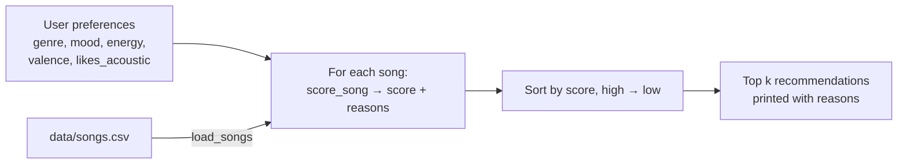

# 🎵 Music Recommender Simulation

## Project Summary

In this project you will build and explain a small music recommender system.

Your goal is to:

- Represent songs and a user "taste profile" as data
- Design a scoring rule that turns that data into recommendations
- Evaluate what your system gets right and wrong
- Reflect on how this mirrors real world AI recommenders

This version, **GenreGenie 1.0**, is a small content-based recommender that runs in the terminal. It loads a 20-song catalog from `data/songs.csv`, scores every song against a user's taste profile (favorite genre, favorite mood, target energy, target valence, and whether they like acoustic music), and prints the top 5 songs with a score and a plain-language list of reasons for each one.

---

## How The System Works

### How real recommenders work

Big platforms like Spotify and YouTube mix two ideas. **Collaborative filtering** looks at behavior: if lots of people who played song A also played song B, and you played A, you probably get B. It learns from likes, skips, replays, saves, playlist adds, and listening time, and it doesn't need to know anything about the music itself, but it struggles with brand-new songs and brand-new users (the "cold start" problem). **Content-based filtering** looks at the songs themselves: genre, mood, tempo, energy, how acoustic or danceable a track is. It compares those attributes to what a user already likes, so it works on day one, but it tends to keep suggesting more of the same. Real systems blend both at huge scale, and add context like time of day and device.

My version is **purely content-based**. It has no listening history, so it can only compare song attributes to a stated taste profile. It prioritizes **genre first, then mood, then how close the song's energy and valence are** to what the user wants, with a small bonus for acoustic songs if the user likes that sound.

### Features used

**`Song`** (one row of `data/songs.csv`): `id`, `title`, `artist`, `genre`, `mood`, `energy` (0–1), `tempo_bpm`, `valence` (0–1, how happy/positive it sounds), `danceability` (0–1), `acousticness` (0–1). The scorer uses `genre`, `mood`, `energy`, `valence`, and `acousticness`; tempo and danceability are loaded but not scored (tempo mostly tracks energy).

**`UserProfile`**: `favorite_genre`, `favorite_mood`, `target_energy`, `target_valence` (optional), `likes_acoustic`. In `src/main.py` the same preferences are written as a plain dictionary: `genre`, `mood`, `energy`, `valence`, `likes_acoustic`.

### Algorithm recipe

**Scoring rule (one song):**

| Check | Points |
|---|---|
| Genre is an exact match | +2.0 |
| Genre is *related* (one name contains the other, like `k-pop` / `pop`, or both are in the same family in `src/genres.py`, like `grunge` / `rock`) | +1.0 |
| Mood is an exact match | +1.0 |
| Energy closeness: `1 - |song energy - target energy|` | 0.0 to +1.0 |
| Valence closeness: `1 - |song valence - target valence|` (skipped if the profile has no valence) | 0.0 to +1.0 |
| User likes acoustic and the song's acousticness is 0.6 or higher | +0.5 |

The best possible score is **5.5**. Closeness rewards songs that are *near* the target instead of just "more energy is better". A song exactly at the target gets the full point, and one at the opposite end gets close to zero. Every time points are added, a reason is recorded (for example `genre match (+2.0)`), so each recommendation explains itself.

**Ranking rule (the whole list):** score every song in the catalog, sort from highest to lowest score (ties go alphabetically by title), and return the top `k` (default 5). You need both rules: the scoring rule judges one song on its own, and the ranking rule compares all those judgments to pick the winners.

### Data flow



### Biases I expect

- **Genre dominates.** A genre match (+2.0) is worth more than mood and energy combined for most songs, so a great song with the right mood and energy but the "wrong" genre may never reach the top 5.
- **The catalog is tiny and uneven.** Lofi has three songs and most genres have one, so some users get a full list of their genre and others get one match followed by filler.
- **Exact labels are fragile.** Mood only matches if the words are identical (`sad` and `melancholy` count as different moods), and the genre-family map only knows the genres I typed into it.
- **Middle-of-the-road songs win ties.** Closeness scoring rewards songs near the target, so users with extreme targets (energy 0.0 or 1.0) have fewer songs close to them.

---

## Getting Started

### Setup

1. Create a virtual environment (optional but recommended):

   ```bash
   python -m venv .venv
   source .venv/bin/activate      # Mac or Linux
   .venv\Scripts\activate         # Windows
   ```

2. Install dependencies

```bash
pip install -r requirements.txt
```

3. Run the app:

```bash
python -m src.main
```

### Running Tests

Run the starter tests with:

```bash
pytest
```

You can add more tests in `tests/test_recommender.py`.

---

## Sample Recommendation Output

Output of `python -m src.main` for the default "pop / happy" profile (the full run, with every profile, is in [model_card.md](model_card.md#7-evaluation)):

```
Loaded songs: 20

=== High-Energy Pop (genre=pop, mood=happy, energy=0.8, valence=0.85, likes_acoustic=False) ===
 1. Sunrise City (Neon Echo)             4.97  genre match (+2.0); mood match (+1.0); energy 0.82 vs 0.80 (+0.98); valence 0.84 vs 0.85 (+0.99)
 2. Rooftop Lights (Indigo Parade)       3.92  related genre indie pop ~ pop (+1.0); mood match (+1.0); energy 0.76 vs 0.80 (+0.96); valence 0.81 vs 0.85 (+0.96)
 3. Starlight Dash (NOVA9)               3.87  related genre k-pop ~ pop (+1.0); mood match (+1.0); energy 0.88 vs 0.80 (+0.92); valence 0.90 vs 0.85 (+0.95)
 4. Gym Hero (Max Pulse)                 3.79  genre match (+2.0); energy 0.93 vs 0.80 (+0.87); valence 0.77 vs 0.85 (+0.92)
 5. Bassline Voltage (Kilowatt Kids)     1.80  energy 0.95 vs 0.80 (+0.85); valence 0.80 vs 0.85 (+0.95)
```

Each line shows the rank, title and artist, the total score (out of 5.5), and the reasons that added up to that score.

---

## Experiments You Tried

### Profiles and edge cases

`src/main.py` runs seven profiles: my own ("Me", a metal/intense listener), High-Energy Pop, Chill Lofi, Deep Intense Rock, and three edge cases (a genre that isn't in the catalog, a metal fan who likes acoustic music, and an empty profile). The full output for every profile, plus a comparison of each pair of profiles, is in [model_card.md → Evaluation](model_card.md#7-evaluation).

### Weight shift: genre halved, energy doubled

I temporarily changed the weights at the top of `src/recommender.py` and ran `python -m src.main` again, then reverted them:

| Weight | Normal | Experiment |
|---|---|---|
| Exact genre | 2.0 | 1.0 |
| Related genre | 1.0 | 0.5 |
| Energy closeness | 1.0 | 2.0 |

The best possible score is still 5.5, so the scale didn't change. Only the balance did.

**What changed:**

- **Chill Lofi:** Concrete Crown (upbeat hip-hop, energy 0.78) dropped out and Coffee Shop Stories (calm acoustic jazz) came in. Spacewalk Thoughts passed Focus Flow because its mood match now counts as much as Focus Flow's genre match. *More accurate.*
- **Acoustic Headbanger:** the mid- and low-energy acoustic songs (country, lofi) fell out and high-energy songs replaced them. *More accurate.*
- **Deep Intense Rock:** Iron Tide (metal) moved up from #4 to #3. *Slightly more accurate.*
- **High-Energy Pop:** the top 4 stayed the same, and #5 swapped an edm song for a hip-hop song. *Just different.*

Experiment output:

```
Loaded songs: 20

=== High-Energy Pop (genre=pop, mood=happy, energy=0.8, valence=0.85, likes_acoustic=False) ===
 1. Sunrise City (Neon Echo)             4.95  genre match (+1.0); mood match (+1.0); energy 0.82 vs 0.80 (+1.96); valence 0.84 vs 0.85 (+0.99)
 2. Rooftop Lights (Indigo Parade)       4.38  related genre indie pop ~ pop (+0.5); mood match (+1.0); energy 0.76 vs 0.80 (+1.92); valence 0.81 vs 0.85 (+0.96)
 3. Starlight Dash (NOVA9)               4.29  related genre k-pop ~ pop (+0.5); mood match (+1.0); energy 0.88 vs 0.80 (+1.84); valence 0.90 vs 0.85 (+0.95)
 4. Gym Hero (Max Pulse)                 3.66  genre match (+1.0); energy 0.93 vs 0.80 (+1.74); valence 0.77 vs 0.85 (+0.92)
 5. Concrete Crown (Verse Theory)        2.73  energy 0.78 vs 0.80 (+1.96); valence 0.62 vs 0.85 (+0.77)

=== Chill Lofi (genre=lofi, mood=chill, energy=0.35, valence=0.6, likes_acoustic=True) ===
 1. Library Rain (Paper Lanterns)        5.50  genre match (+1.0); mood match (+1.0); energy 0.35 vs 0.35 (+2.00); valence 0.60 vs 0.60 (+1.00); acoustic sound (+0.5)
 2. Midnight Coding (LoRoom)             5.32  genre match (+1.0); mood match (+1.0); energy 0.42 vs 0.35 (+1.86); valence 0.56 vs 0.60 (+0.96); acoustic sound (+0.5)
 3. Spacewalk Thoughts (Orbit Bloom)     4.81  related genre ambient ~ lofi (+0.5); mood match (+1.0); energy 0.28 vs 0.35 (+1.86); valence 0.65 vs 0.60 (+0.95); acoustic sound (+0.5)
 4. Focus Flow (LoRoom)                  4.39  genre match (+1.0); energy 0.40 vs 0.35 (+1.90); valence 0.59 vs 0.60 (+0.99); acoustic sound (+0.5)
 5. Coffee Shop Stories (Slow Stereo)    3.35  energy 0.37 vs 0.35 (+1.96); valence 0.71 vs 0.60 (+0.89); acoustic sound (+0.5)

=== Deep Intense Rock (genre=rock, mood=intense, energy=0.9, valence=0.4, likes_acoustic=False) ===
 1. Storm Runner (Voltline)              4.90  genre match (+1.0); mood match (+1.0); energy 0.91 vs 0.90 (+1.98); valence 0.48 vs 0.40 (+0.92)
 2. Gym Hero (Max Pulse)                 3.57  mood match (+1.0); energy 0.93 vs 0.90 (+1.94); valence 0.77 vs 0.40 (+0.63)
 3. Iron Tide (Black Anvil)              2.68  energy 0.97 vs 0.90 (+1.86); valence 0.22 vs 0.40 (+0.82)
 4. Night Drive Loop (Neon Echo)         2.61  energy 0.75 vs 0.90 (+1.70); valence 0.49 vs 0.40 (+0.91)
 5. Concrete Crown (Verse Theory)        2.54  energy 0.78 vs 0.90 (+1.76); valence 0.62 vs 0.40 (+0.78)

=== Edge: Genre Not In Catalog (genre=polka, mood=happy, energy=0.6) ===
 1. Rooftop Lights (Indigo Parade)       2.68  mood match (+1.0); energy 0.76 vs 0.60 (+1.68)
 2. Sunrise City (Neon Echo)             2.56  mood match (+1.0); energy 0.82 vs 0.60 (+1.56)
 3. Starlight Dash (NOVA9)               2.44  mood match (+1.0); energy 0.88 vs 0.60 (+1.44)
 4. Island Time (Sol Rocker)             2.00  energy 0.60 vs 0.60 (+2.00)
 5. Dirt Road Letters (Hollis Grey)      1.90  energy 0.55 vs 0.60 (+1.90)

=== Edge: Acoustic Headbanger (genre=metal, energy=0.95, likes_acoustic=True) ===
 1. Iron Tide (Black Anvil)              2.96  genre match (+1.0); energy 0.97 vs 0.95 (+1.96)
 2. Bassline Voltage (Kilowatt Kids)     2.00  energy 0.95 vs 0.95 (+2.00)
 3. Gym Hero (Max Pulse)                 1.96  energy 0.93 vs 0.95 (+1.96)
 4. Storm Runner (Voltline)              1.92  energy 0.91 vs 0.95 (+1.92)
 5. Starlight Dash (NOVA9)               1.86  energy 0.88 vs 0.95 (+1.86)

=== Edge: Empty Profile (no preferences) ===
 1. Bassline Voltage (Kilowatt Kids)     0.00  no preferences matched
 2. Coffee Shop Stories (Slow Stereo)    0.00  no preferences matched
 3. Concrete Crown (Verse Theory)        0.00  no preferences matched
 4. Dirt Road Letters (Hollis Grey)      0.00  no preferences matched
 5. Empty Station Blues (Earl Mason)     0.00  no preferences matched
```

---

## Limitations and Risks

- **Tiny, uneven catalog:** 20 songs, most genres have one song, and lofi has three.
- **Genre dominates:** an exact genre match outweighs a perfect energy and valence fit, so "right label, wrong vibe" songs (like Gym Hero for a happy-pop fan) still rank high.
- **The genre map is hand-made:** which genres count as "related" is my judgment call. Lofi is linked to hip-hop but metal isn't linked to rock, and that unevenness changes who gets good results.
- **Exact-word moods:** "sad" and "melancholy" get no credit for each other.
- **No real understanding of music:** no lyrics, language, audio, or listening history. Only labels and a few numbers.

More detail is in the model card's [Limitations and Bias](model_card.md#6-limitations-and-bias) section.

---

## Reflection

Read and complete `model_card.md`:

[**Model Card**](model_card.md)

**What I learned about turning data into predictions.** A recommender like this one boils a song down to a few labels and numbers, scores how close each song is to what a user says they like, and sorts the list. I was expecting a lot more identifiers, like pitch, vocal timbre, and instrumentation, but for a simple implementation the features we chose make sense, and the lists mostly felt right. Still, something as complex as music is hard to pin down with just numbers, let alone genre. A recommendation from a real person comes with a conversation and a personality behind it, and an algorithm can't match that depth.

**Where bias and unfairness show up.** A big issue with music recommenders in general is that they draw on what's new and what's popular rather than what might actually be good. All taste is also subjective: a song that one metalhead loves, another might find atrocious. Someone looking for niche music, or with a very particular taste, gets the worst end of the stick from a system like this. A passive listener who simply cares that the music is in the right genre gets the most out of it. In my own version the bias also comes from my labeling choices: the hand-made genre map decides which genres count as "related" (lofi is linked to hip-hop, but metal isn't linked to rock), and that changes who gets good results.
